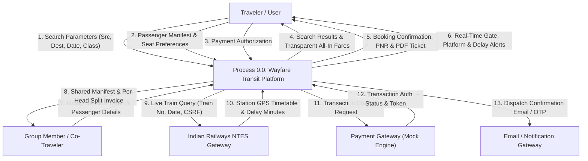
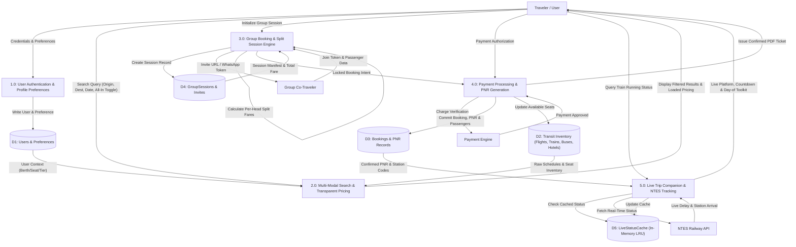
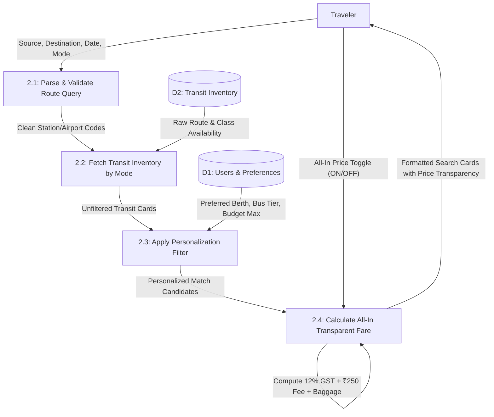
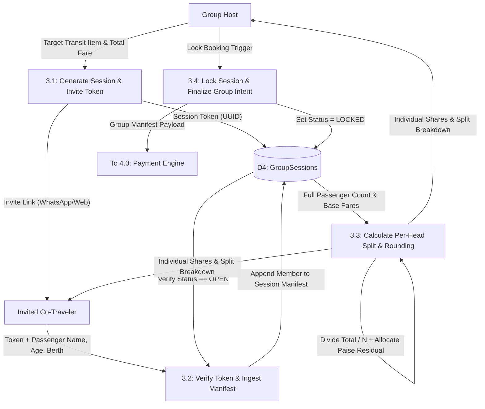
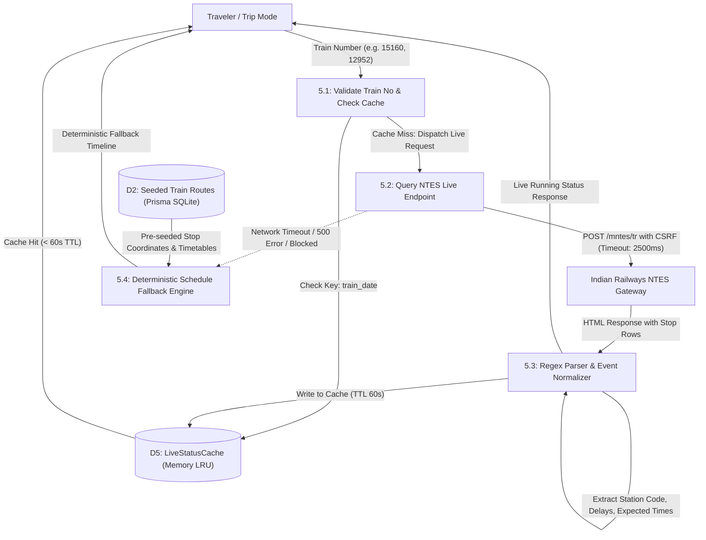
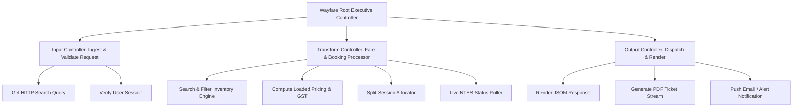

# Wayfare — Data Flow Diagrams (DFDs) & Structured Analysis Specification

> **Course Mapping:** Unit 2 — Structured Analysis / Structured Design (SA/SD) Methodology  
> **Notations Used:** Gane & Sarson / Yourdon-Coad Modern Notation  
> **System:** Wayfare Multi-Modal Transit & Booking Platform

---

## Table of Contents
1. [DFD Conventions & Notation](#1-dfd-conventions--notation)
2. [Level 0 DFD: Context Analysis Diagram](#2-level-0-dfd-context-analysis-diagram)
3. [Level 1 DFD: System Functional Decomposition](#3-level-1-dfd-system-functional-decomposition)
4. [Level 2 DFDs: Detailed Sub-Process Decompositions](#4-level-2-dfds-detailed-sub-process-decompositions)
   - [2.1 Sub-Process 2.0: Multi-Modal Search & Transparent Pricing](#41-sub-process-20-multi-modal-search--transparent-pricing)
   - [2.2 Sub-Process 3.0: Collaborative Group Booking & Split Session](#42-sub-process-30-collaborative-group-booking--split-session)
   - [2.3 Sub-Process 5.0: Live Train Tracking & Fallback Telemetry](#43-sub-process-50-live-train-tracking--fallback-telemetry)
5. [Extending DFD to Structure Chart (SA/SD Methodology)](#5-extending-dfd-to-structure-chart-sasd-methodology)
6. [Data Dictionary (DD) & Balancing Verification](#6-data-dictionary-dd--balancing-verification)
7. [Examiner Viva Voce Defense on DFDs](#7-examiner-viva-voce-defense-on-dfds)

---

## 1. DFD Conventions & Notation

Data Flow Diagrams (DFDs) model how data moves through an information system, where it is transformed, and where it is stored. DFDs focus strictly on **data flow**, without modeling control loops, branches, or sequential procedural steps (unlike flowcharts).

| Element | Symbol / Representation | Meaning in Wayfare |
| :--- | :--- | :--- |
| **External Entity** | Square / Rectangle `[Entity]` | Outside actor that generates or consumes data (e.g., Traveler, IRCTC/NTES Gateway, Payment Processor). |
| **Process** | Circle or Rounded Box `((Process))` | Transformation of incoming data flows into outgoing data flows (e.g., Calculate Fare, Generate PNR). |
| **Data Store** | Two parallel lines or Open Box `[(Data Store)]` | Repository where data rests at rest (e.g., Users, Bookings, GroupSessions). |
| **Data Flow** | Directed Arrow `-->|Data|` | Pipeline transferring data packets between entities, processes, and stores. |

---

## 2. Level 0 DFD: Context Analysis Diagram

The Context Diagram defines the **system boundaries**. The entire Wayfare platform is represented as a single process (`Process 0.0`), interacting exclusively with external environment actors.



---

## 3. Level 1 DFD: System Functional Decomposition

Level 1 breaks `Process 0.0` into the five core subsystems of Wayfare, demonstrating how data flows into, between, and out of internal database stores.



---

## 4. Level 2 DFDs: Detailed Sub-Process Decompositions

### 4.1 Sub-Process 2.0: Multi-Modal Search & Transparent Pricing

Decomposes the search query lifecycle, inventory retrieval, preference weighting, and all-in dynamic fare calculation.



---

### 4.2 Sub-Process 3.0: Collaborative Group Booking & Split Session

Decomposes the collaborative booking architecture (`/group/[token]`), showing how distributed travelers contribute to a single manifest and split the invoice.



---

### 4.3 Sub-Process 5.0: Live Train Tracking & Fallback Telemetry

Decomposes the resilient NTES integration (`liveTrainTracker.ts`), demonstrating how cache hits, live scraping, and deterministic Prisma fallbacks are coordinated.



---

## 5. Extending DFD to Structure Chart (SA/SD Methodology)

In Structured Analysis and Structured Design (SA/SD), the DFD is transformed into a **Structure Chart** using **Transform Analysis** and **Transaction Analysis**.

- **Transform Center:** Identifies the central processing hub where incoming physical data is converted into abstract data, processed, and transformed into physical output.
- **Data Couples ($o\rightarrow$):** Data passed between modules.
- **Control Flags ($\bullet\rightarrow$):** Boolean flags controlling flow (e.g., `isAuthorized`, `cacheHit`).



---

## 6. Data Dictionary (DD) & Balancing Verification

### Data Dictionary Entries

```text
Search_Query = Source_Station + Destination_Station + Journey_Date + Mode + [Travel_Class] + [All_In_Toggle]

Passenger_Manifest = { Passenger_Name + Age + Gender + [Seat_Berth_Preference] }1..6

Group_Session = Session_Token + Host_User_Id + Target_Item_Id + Status + { Passenger_Manifest } + Total_Fare + Per_Head_Split
  where Status = [ "OPEN" | "LOCKED" | "COMPLETED" | "EXPIRED" ]

Live_Train_Status = Train_Number + Train_Name + Run_Date + Last_Updated + Current_Station_Code + 
                    Current_Station_Name + Overall_Delay_Mins + Is_Delayed + { Station_Stop_Timeline }

Station_Stop_Timeline = Station_Code + Station_Name + Scheduled_Arr + Scheduled_Dep + 
                        Expected_Arr + Expected_Dep + Delay_Mins + Distance_Km + Status
  where Status = [ "DEPARTED" | "CURRENT" | "UPCOMING" ]
```

### DFD Balancing Rule (Conservation of Data)
A set of DFDs is **balanced** if all input and output data flows that cross the boundary of a parent process match the net inputs and outputs of the child DFD diagram.
- **Level 0 vs Level 1 Verification:**
  - Net inputs into Context Diagram (Traveler, Co-traveler, NTES, PG, Email) $\equiv$ Net inputs entering Level 1 DFD processes.
  - Zero spontaneous data generation (**Miracle Error** avoided).
  - Zero data sinks without outputs (**Black Hole Error** avoided).
  - All data store accesses in Level 2 correspond to verified entities in Prisma ORM (`prisma/schema.prisma`).

---

## 7. Examiner Viva Voce Defense on DFDs

### Q1: *"What is the fundamental difference between a DFD and a Flowchart?"*
> **Model Answer:**
> *"A flowchart models sequential control logic—it shows step-by-step program execution paths, decision diamonds, loops, and temporal order. In contrast, a DFD models the flow and transformation of data through the system regardless of time or implementation order. A DFD has no 'loops' or 'if-else' statements; it answers **what** data moves where, while a flowchart answers **how** and **when** a program executes."*

### Q2: *"What are Black Holes, Miracles, and Grey Holes in DFD analysis, and how did you prevent them?"*
> **Model Answer:**
> - *"A **Black Hole** is a process with only input flows and no output flows."*
> - *"A **Miracle** is a process that generates output flows out of nothing without any inputs."*
> - *"A **Grey Hole** occurs when a process's outputs could not logically be generated by its inputs (e.g., an input of `UserId` generating a `FlightTicketPDF` without accessing the booking database)."*
> - *"In Wayfare, all 5 Level 1 processes were verified for strict input/output balance against our Data Dictionary, ensuring every output is mathematically derivable from its inputs and data store reads."*

### Q3: *"How does DFD Level 1 relate to your project's codebase?"*
> **Model Answer:**
> *"Every Level 1 process maps directly to a high-cohesion module in Wayfare:*
> - *Process 1.0 $\rightarrow$ `src/server/auth` and `/api/preferences`.*
> - *Process 2.0 $\rightarrow$ `src/lib/domain/pricing.ts` and `/api/{mode}/search`.*
> - *Process 3.0 $\rightarrow$ `src/app/api/group/*` and `/group/[token]`.*
> - *Process 4.0 $\rightarrow$ `/api/bookings/create` and `pdf-lib` ticket generator.*
> - *Process 5.0 $\rightarrow$ `src/server/providers/liveTrainTracker.ts` and `/trains/running-status`.*
> *This 1-to-1 traceability proves our software engineering was architecturally planned before implementation."*
