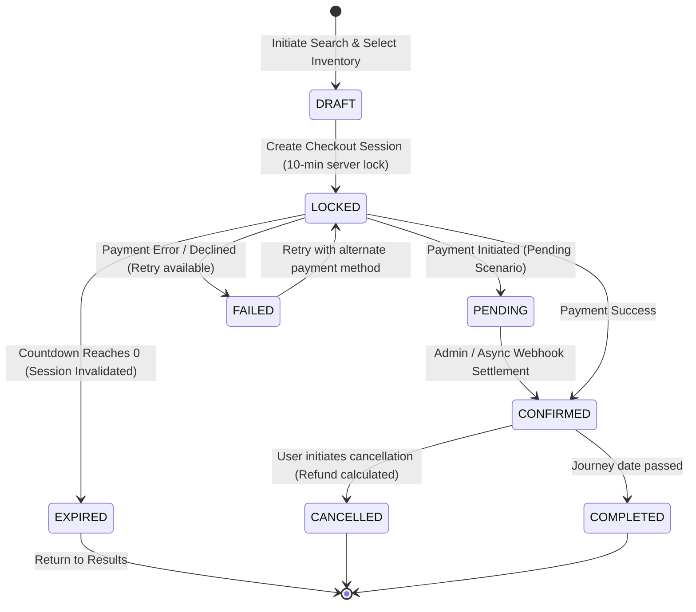

# Wayfare — Architecture & Technical Specifications

Wayfare is designed as an offline-first, production-grade travel booking and trip orchestration platform. It models real-world travel systems (GDS, IRCTC PNR/NTES, bus aggregators, hotel inventory engines) behind clean TypeScript provider interfaces.

---

## 1. System Topology

```
┌────────────────────────────────────────────────────────────────────────┐
│                        Next.js App Router (14+)                        │
│                                                                        │
│  [Public Pages]       [Booking Flow]          [Account & Admin]        │
│  - /flights           - /checkout/[sessionId] - /trips (+ grouped)     │
│  - /trains (+ PNR,    - /booking/[bookingId]  - /wallet                │
│    live status)       - /dev/emails           - /alerts                │
│  - /buses                                     - /admin (role-gated)    │
│  - /hotels                                    - /dev/ui (design specs) │
└──────────────────┬─────────────────────────────────┬───────────────────┘
                   │                                 │
                   ▼                                 ▼
┌──────────────────────────────────────┐  ┌──────────────────────────────┐
│        Server Route Handlers         │  │     Pure Domain Logic        │
│  - /api/flights/*                    │  │     (src/lib/domain/)        │
│  - /api/trains/*                     │  │  - Result<T, E> Pattern      │
│  - /api/buses/*                      │  │  - Pricing Engine            │
│  - /api/hotels/*                     │  │  - Refund Tier Matrix        │
│  - /api/checkout/*                   │  │  - Train WL Heuristic Model  │
│  - /api/admin/*                      │  │  - INR Currency Formatting   │
└──────────────────┬───────────────────┘  └──────────────────────────────┘
                   │
                   ▼
┌────────────────────────────────────────────────────────────────────────┐
│                     Mock Travel Provider Adapters                      │
│                      (src/server/providers/)                           │
│  FlightProvider  ·  TrainProvider  ·  BusProvider  ·  HotelProvider    │
└──────────────────┬─────────────────────────────────────────────────────┘
                   │
                   ▼
┌────────────────────────────────────────────────────────────────────────┐
│                     Prisma ORM + SQLite dev.db                         │
│   Mulberry32 PRNG Seeded Database (40 airports, 40 stations,           │
│   333 flights, 120 trains, 190 buses, 150 hotels, demo users)          │
└────────────────────────────────────────────────────────────────────────┘
```

---

## 2. Booking State Machine



---

## 3. Key Design Principles

1. **Zero External API Dependencies**:
   All flight schedules, train stops, bus layouts, and hotel rooms run completely offline via SQLite and Prisma.
2. **Deterministic Seed Data**:
   A seeded Pseudo-Random Number Generator (Mulberry32) populates hundreds of realistic travel sectors, ensuring reproducible demos without flaky network calls.
3. **Pure Functional Domain Logic**:
   Fare breakdown formulas, tiered cancellation penalties, and train confirmation probabilities live in pure, zero-dependency functions (`src/lib/domain/`) with 100% unit test coverage.
4. **Server Recomputed Checkout Security**:
   The frontend never passes total payable amounts. The server re-evaluates base fares, taxes, convenience fees, and promo code constraints at payment execution.
5. **PDF E-Ticket Generation**:
   Using `pdf-lib`, boarding passes and e-tickets are generated on-the-fly server-side and downloaded without third-party cloud binaries.
