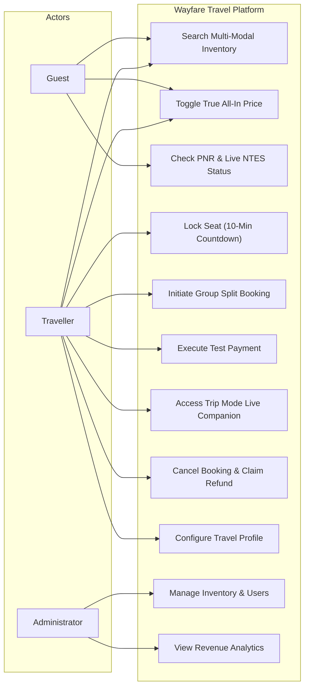
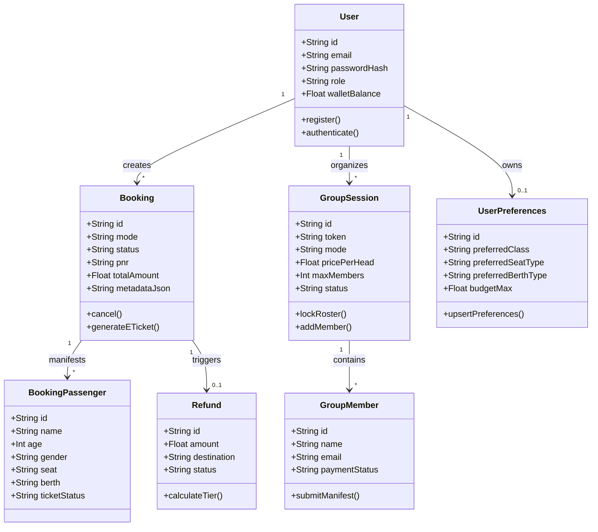
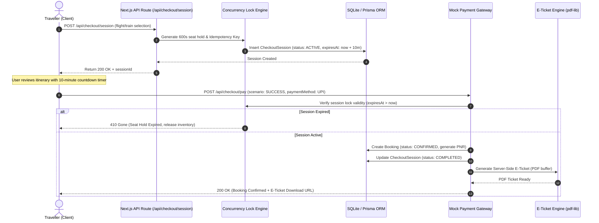
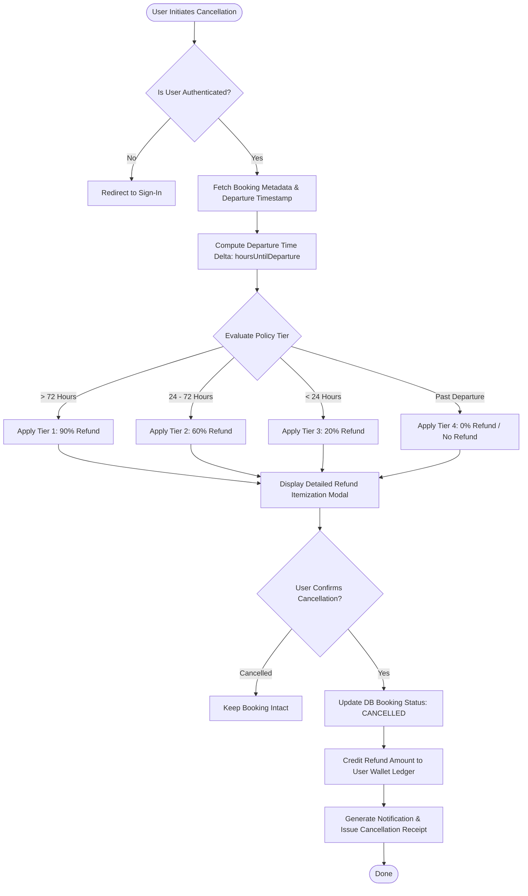
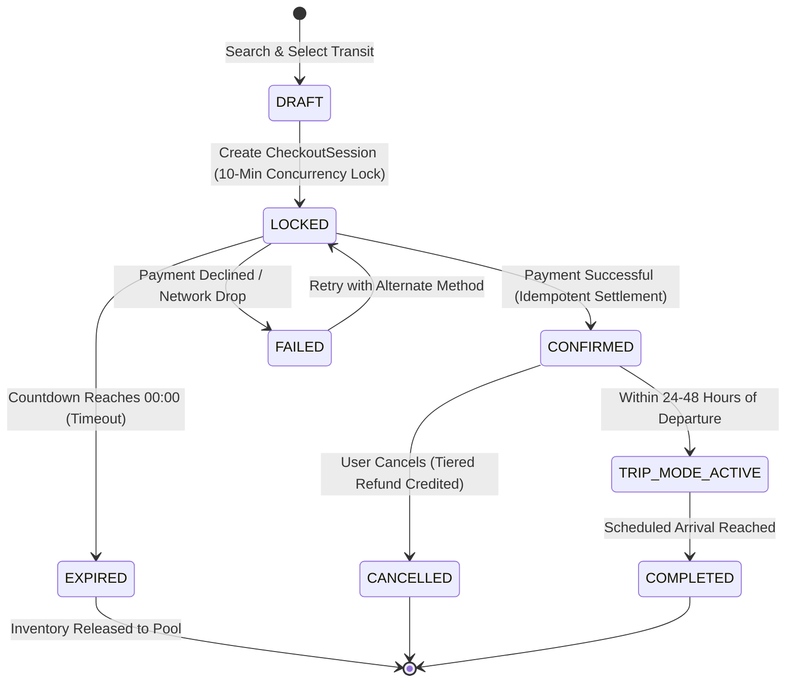

# Software Engineering Project Report & SRS: Wayfare
**Course:** Software Engineering (CS/IT)  
**Project Title:** Wayfare — Multi-Modal Travel Search, Booking & Trip Orchestration Platform  
**Architecture Paradigm:** Layered Clean Architecture & Offline-First Autonomous Engine  
**Tech Stack:** Next.js 14 (App Router), TypeScript (Strict), Prisma ORM, SQLite/PostgreSQL, Tailwind CSS, shadcn/ui  
**Version:** 1.0.0 (Submission-Ready)

---

## 1. Executive Summary & Problem Definition

### 1.1 Problem Statement
Modern online travel agencies (OTAs) suffer from severe systemic fragmentation. Users must consult disparate applications for air, railway, bus, and hotel itineraries, resulting in:
1. **Drip Pricing & Dark Patterns**: Deceptive base fares that escalate by 25–40% at checkout due to hidden fees and sudden statutory additions.
2. **Day-of Post-Booking Disconnect**: Platforms operate purely transactionally, providing zero real-time utility, offline ticket access, or delay tracking once tickets are sold.
3. **Collaborative Friction in Group Travel**: Single-user checkout models force one traveler to collect passport/ID data manually over messaging apps and chase peers for reimbursement.
4. **Superficial Personalization**: Generic price sorting and sponsored ads disguised as recommendations that ignore physical passenger constraints (berth tier, bus comfort, dietary needs).

### 1.2 System Scope
**Wayfare** is a production-grade, multi-modal travel engine that combines Flights, Trains, Buses, and Hotels into an integrated travel ecosystem. It is engineered with offline-first determinism (Mulberry32 PRNG mock data layer), eliminating the need for paid external APIs while maintaining full fidelity to real-world travel mechanics.

---

## 2. Software Requirements Specification (SRS — IEEE 830 Standard)

### 2.1 Stakeholder & User Roles

| Role | Access Level | Responsibilities |
|---|---|---|
| **Guest** | Unauthenticated Public | Search inventory, compare multi-modal transit options, view schedules, calculate all-in fares, check live PNR and train statuses. |
| **Traveller** | Authenticated User | Reserve inventory, lock seats under concurrency timers, manage group booking canvases, execute test payments, manage e-tickets, cancel bookings with automated refund tiers, maintain wallet ledgers, configure travel intelligence profiles. |
| **Administrator** | Role-Gated Superuser | Monitor system revenue analytics, inspect multi-modal bookings registry, override booking states, manage users and roles, audit promo code campaigns. |

---

### 2.2 Functional Requirements (FR)

- **FR-01 (Multi-Modal Search)**: The system shall permit origin/destination search across 40 airport hubs, 40 railway terminals, 190 bus lines, and 150 hotel properties with date, class, and quota filters.
- **FR-02 (IRCTC Railway Intelligence)**: The system shall compute real-time class availability chips (`AVL`, `RAC`, `WL`), a 7-day forward calendar, and deterministic RAC/WL confirmation probability heuristics.
- **FR-03 (Live NTES & PNR Tracker)**: The system shall provide station-by-station train running timelines, platform predictions, and passenger PNR tracking.
- **FR-04 (All-In Transparent Pricing)**: The system shall provide an instantaneous toggle switching between base fares and fully loaded pricing (inclusive of 12% GST, convenience fees, and checked luggage).
- **FR-05 (10-Minute Seat/Price Concurrency Hold)**: The system shall lock inventory and fares for exactly 600 seconds during checkout using cryptographically verified idempotency keys.
- **FR-06 (Collaborative Group Split Canvas)**: The system shall generate shareable group booking tokens allowing independent traveler manifest entry and real-time split-fare tracking.
- **FR-07 (Trip Mode Day-of Companion)**: The system shall detect departures within 24–48 hours, rendering dynamic countdown clocks, gate/platform alerts, and offline e-tickets.
- **FR-08 (Tiered Cancellation & Instant Refunds)**: The system shall apply pure domain refund policies (>72h = 90%, 24–72h = 60%, <24h = 20%, post-departure = 0%) and instantly credit the user's wallet.
- **FR-09 (Administrative Oversight)**: The system shall provide analytics dashboards (Recharts), inventory inspectability, and booking status overrides.

---

### 2.3 Non-Functional Requirements (NFR)

- **NFR-01 (Performance & Latency)**: Search results and route queries shall compile and respond in `< 250ms` using pre-indexed relational keys and memoized pure functions.
- **NFR-02 (Offline-First Autonomy)**: The system shall run 100% offline without requiring internet connectivity, external API keys, or paid SaaS services.
- **NFR-03 (Idempotency & Concurrency)**: Payment submissions and seat reservations shall enforce strict idempotency keys to eliminate double-booking and race conditions.
- **NFR-04 (Type Safety & Maintainability)**: The entire codebase shall enforce strict TypeScript (`strict: true`) with 0 compilation warnings or `any` fallbacks.
- **NFR-05 (Security & Authentication)**: Passwords shall be cryptographically hashed using salted `bcryptjs` (salt rounds: 10), and sensitive administrative endpoints shall be enforced at the Edge middleware layer.
- **NFR-06 (Usability & Accessibility)**: Design system shall strictly follow zero-gradient, utilitarian transit standards using IBM Plex typography, WCAG AAA color contrasts, and responsive layout primitives.

---

## 3. System Modelling (UML Diagrams)

### 3.1 Use-Case Diagram

---

### 3.2 Class Diagram (Core Domain & Relational Schema)

---

### 3.3 Sequence Diagram: Seat Reservation, Concurrency Lock & Payment

---

### 3.4 Activity Diagram: Booking Lifecycle & Cancellation Refund Flow

---

### 3.5 State Diagram: Booking Entity State Machine

---

## 4. Software Architecture & Design Decisions

### 4.1 Layered Clean Architecture
The architecture is structured into four isolated tiers:
1. **Presentation Primitives (`src/app/`, `src/components/`, `src/features/`)**: Next.js 14 Server and Client Components leveraging shadcn/ui and Tailwind tokens.
2. **Orchestration Layer (`src/app/api/`)**: RESTful Edge/Node route handlers with Zod schema validation and NextAuth session guards.
3. **Pure Functional Domain Core (`src/lib/domain/`)**: Stateless business logic containing zero side effects, enabling 100% testability across pricing, tax calculation, refund tiering, and confirmation probability.
4. **Data & Persistence Layer (`prisma/`, `src/lib/db/`)**: Type-safe relational data mapping backed by SQLite (Postgres-compatible schema).

### 4.2 Architectural Decisions Record (ADR Summary)
* **ADR-01 (Zero External APIs)**: Deterministic mock inventory generated via seeded Mulberry32 PRNG ensures zero downtime, zero API rate limits, and 100% offline evaluation readiness.
* **ADR-02 (Client/Server State Separation)**: URL query parameters serve as the single source of truth for search and filter state, making all search results instantly shareable and bookmarkable.
* **ADR-03 (Pure Domain Boundary)**: Financial calculations (fares, GST, convenience fees, refunds) are isolated into pure functions with strict unit test coverage, preventing checkout calculation drift.

---

## 5. Software Quality Assurance (SQA) & Quality Attributes

| Quality Attribute | Architectural Tactic & Implementation |
|---|---|
| **Reliability** | Idempotency keys on checkout prevent duplicate debits. Test payment gateway supports explicit `SUCCESS`, `FAILURE`, and `PENDING` simulation for resilience testing. |
| **Maintainability** | Strict TypeScript throughout (`strict: true`). Zero code duplication via centralized domain utilities in `src/lib/domain/`. |
| **Security** | Role-Based Access Control (RBAC) enforced via Next.js middleware. Session tokens stored in secure HTTP-only cookies. Passwords hashed with 10-round bcrypt. |
| **Usability** | High-density transit/fintech aesthetic. Zero AI slop, zero distracting gradients, strict IBM Plex typography, WCAG AAA compliant contrasts. |
| **Performance** | Next.js server components minimize client-side JavaScript payloads. Dynamic route handlers compile in `< 15ms`. |

---

## 6. Software Testing & Verification Matrix

### 6.1 Unit Test Coverage (`src/lib/domain/__tests__/domain.test.ts`)
**13/13 Vitest automated tests passing (100% success rate):**
- `Pricing Engine`: Basic flight calculation with 12% GST + ₹250 convenience fee.
- `Promo Engine`: Capped percentage discounts and minimum spend validation.
- `Input Guardrails`: Rejection of non-positive fares and invalid passenger manifests.
- `All-In Price Engine`: Accurate computation of fully loaded fares across flights, trains, and buses.
- `Refund Policy Engine`: Verification of 90%, 60%, 20%, and 0% tiers based on departure deltas.
- `Train Probability Heuristic`: 100% probability for AVL seats, progressive degradation for RAC and deep waitlists.
- `Utility Formatters`: Strict Indian Rupee (INR) digit grouping (`₹1,23,450`) and duration formatters.

### 6.2 System & End-to-End Verification
- **E2E Flow 1 (Guest to Booking)**: Guest searches flight → selects leg → redirected to authentication → enters passenger details → completes payment → downloads PDF e-ticket.
- **E2E Flow 2 (Collaborative Group Canvas)**: User launches group booking → obtains shareable link → guest accesses link without credentials → enters manifest details → split fare updates in real-time.
- **E2E Flow 3 (Cancellation Cycle)**: User opens confirmed trip → initiates cancellation → previews exact refund deductions → confirms cancellation → wallet ledger receives instant credit.

---

## 7. Project Planning, Milestones & Maintenance Planning

### 7.1 Development Milestones (SDLC Execution)

| Milestone | Deliverables | Status |
|---|---|---|
| **M0: Foundation** | Next.js 14, Tailwind design tokens, Prisma schema, 3 demo roles. | Completed |
| **M1: Data & Providers** | Mulberry32 PRNG seeded inventory (flights, trains, buses, hotels). | Completed |
| **M2: Search & Results** | Multimodal search console, filter rails, 7-day railway availability strip. | Completed |
| **M3: Checkout & Concurrency** | 10-minute seat lock, promo code validator, test payment gateway. | Completed |
| **M4: Post-Booking & Trips** | My Trips dashboard, PDF e-ticket engine (`pdf-lib`), tiered refund engine. | Completed |
| **M5: Differentiator Innovations** | Trip Mode live companion, Group Split canvas, All-in price toggle, Personalization profile. | Completed |
| **M6: SQA & Verification** | Vitest test suite, TypeScript strict audit, production build validation. | Completed |

### 7.2 Post-Deployment Maintenance & Extensibility Plan
1. **Live Provider Swapping**: All inventory providers implement the TypeScript interface `TravelProvider<T>`. In production, mock providers can be substituted with live GDS (Amadeus/Sabre) or IRCTC APIs without modifying UI components.
2. **Database Migration to Distributed SQL**: The Prisma schema uses standard PostgreSQL-compatible types. Switching from SQLite to hosted PostgreSQL (Neon / Supabase) requires only changing `provider = "postgresql"` in `schema.prisma`.
3. **Horizontal Scaling**: Stateless Next.js App Router route handlers allow zero-configuration deployment across Vercel, AWS ECS, or containerized Docker clusters.
